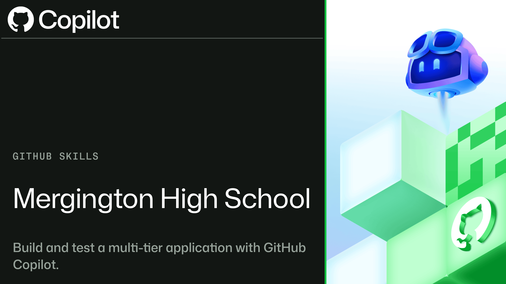

# Build and test a multi-tier application with GitHub Copilot

Hey crisxone!

Mona here. I'm done preparing your exercise. Hope you enjoy! 💚

Remember, it's self-paced so feel free to take a break! ☕️

## Welcome

Build the OctoFit Tracker across MongoDB, Express, and React while following the tier contracts in [docs/architecture.md](docs/architecture.md).

Having trouble? 🤷

Review the architecture, rerun the smallest failing tier test, and use the step instructions for troubleshooting.

